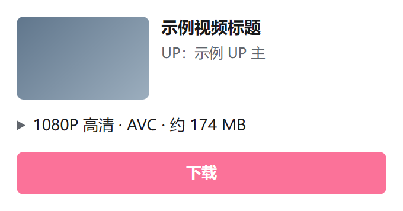
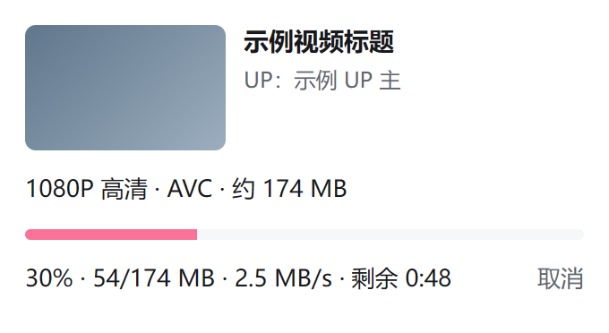
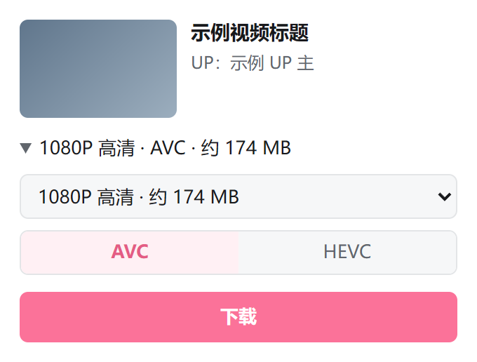
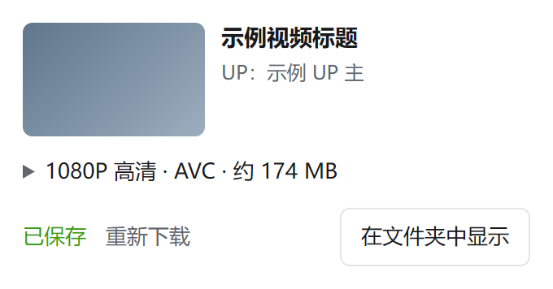

# bDld

bDld 是一个 Chrome / Edge 扩展，扩展名称为「bDld - B站视频离线缓存工具」。在 B 站视频页上，它把正在观看的视频下载并合并为一个标准 MP4 文件，保存到浏览器的下载列表。下载、合并都在本机浏览器中完成，不需要另装程序，也不经过任何第三方服务器。

<p>


</p>

## 功能

- 下载当前视频页正在播放的视频，含分 P；缺省选择播放器当前的清晰度与编码。
- 可改选清晰度与编码（AVC、HEVC、AV1，以视频提供的为准），显示预计大小。
- 视频流与音频流无损合并为一个普通（非分片）MP4，常见播放器与剪辑软件都能打开，拖动进度条即时响应。
- 显示下载进度、速度与剩余时间；关闭弹出窗口不影响下载，扩展图标的角标显示进度。
- 文件进入浏览器的下载列表，遵守浏览器「下载前询问保存位置」等设置；同名文件不覆盖。

<p>


</p>

## 工作原理

1. 读取视频页已经加载的播放数据；数据不属于当前视频时，以页面自身的身份请求一次播放地址，与在播放器中切换一次清晰度相同。
2. 由使用者自己的浏览器下载视频流与音频流。请求头、按索引分段的 Range 请求、视频与音频各一个连接的并发方式，都与 B 站网页播放器相同。
3. 在本机以流式方式把两路流无损合并为标准 MP4，内存占用与视频大小无关。
4. 把合并好的文件交给浏览器的下载列表。

请求方式与正常观看保持一致，目的是避免其他下载工具常遇到的拦截；这不能保证 B 站今后不会限制此类请求。返回内容不是视频数据时，扩展立即停止，不会把错误页面保存为视频。

设计细节见 [docs/DESIGN.md](docs/DESIGN.md)。

## 隐私

- 所有请求都由使用者的浏览器在本机发出，只发往 B 站及其 CDN。
- 没有自己的服务器，不做统计分析，不收集、不保存任何个人数据，也不保存设置。
- 下载媒体时不携带 Cookie。读取播放地址的那一次请求由视频页面发出，携带页面自身的 Cookie，与播放器的请求相同。

扩展申请的权限及用途：

| 权限 | 用途 |
|---|---|
| `activeTab`、`scripting` | 打开弹出窗口时，在当前 B 站视频页读取视频信息与播放地址 |
| `offscreen` | 在后台文档中执行下载与合并 |
| `downloads` | 把合并好的文件交给浏览器下载，并确认已保存的文件是否存在 |
| `declarativeNetRequestWithHostAccess` | 为本扩展发往 B 站 CDN 的请求设置与播放器相同的 Referer、Origin 请求头；不影响其他请求 |
| `unlimitedStorage` | 合并时使用的临时文件可能达到 GB 级；保存完成后删除 |
| 主机权限：`bilibili.com` | 读取视频页的信息 |
| 主机权限：`bilivideo.com`、`bilivideo.cn`、`akamaized.net` | 从 B 站的主 CDN 与备用 CDN 下载媒体 |

完整的隐私政策见 [docs/PRIVACY.md](docs/PRIVACY.md)。

## 安装

浏览器要求：Chrome 或 Edge 116 及以上。

- **从发布包安装**：在 Releases 页面下载 `bDld-<版本>.zip`，解压到一个固定目录。打开 `chrome://extensions`（Edge 为 `edge://extensions`），开启「开发者模式」，点击「加载已解压的扩展程序」，选择解压后的目录。
- **从应用商店安装**：上架后提供。
- **从源代码构建**：安装 Node.js 20 或更高版本，在项目目录执行 `npm ci` 与 `npm run build`，按上述方法加载 `dist` 目录。

## 使用

1. 打开 `www.bilibili.com/video/` 开头的视频页面。
2. 点击工具栏上的 bDld 图标。弹出窗口显示将要下载的清晰度、编码与预计大小；需要其他清晰度或编码时，点击该行展开后改选。
3. 点击「下载」。
4. 完成后点击「在文件夹中显示」。需要再次下载时点击「重新下载」，新文件名会追加序号。

文件名格式：`标题[ - P分P号 分P标题] [BV号] 清晰度.mp4`。

未登录时只能下载播放器提供的清晰度（通常最高 480P），登录 B 站后可下载账号可用的更高清晰度。

## 限制

- 只支持普通投稿视频（含分 P），不支持番剧、课程、直播。
- 只支持 Chromium 内核的浏览器（Chrome、Edge）。
- 音频只保存 AAC，暂不提供 Hi-Res（FLAC）与杜比全景声。
- 下载期间需要约两倍于视频大小的磁盘空间：一份是扩展的临时文件，一份是浏览器保存的文件；临时文件在保存完成后删除。
- 不支持断点续传；下载过程中关闭浏览器，任务失败。
- 一次下载一个视频，其余任务排队。

## 开发

```
npm ci
npm run build       # 构建到 dist
npm run typecheck   # TypeScript 类型检查
npm test            # 单元测试（Vitest）
npm run package     # 构建并生成 release/bDld-<版本>.zip
```

检查脚本：

| 命令 | 内容 |
|---|---|
| `npm run verify:remux` | 合并结果与 `ffmpeg -c copy` 逐包对照（pts、dts、时长、关键帧标志、大小、MD5） |
| `npm run smoke` | 在 Chromium 中加载扩展，确认 service worker 注册成功 |
| `npm run check:engine` | 本地服务器模拟 CDN，检查下载引擎（重试、拦截页、地址过期、排队、取消、临时文件清理） |
| `npm run check:popup` | 把 B 站域名解析到本地 HTTPS 服务器，离线检查弹出窗口与完整下载流程 |
| `npm run check:speed` | 在限速的本地 CDN 上对照实际速度与显示的速度 |
| `npm run screenshots` | 生成 README 与应用商店使用的截图 |
| `npm run e2e` | 打开一个真实的公开视频，下载一次并检查结果 |

环境变量：

| 变量 | 用途 | 缺省 |
|---|---|---|
| `FFMPEG_DIR` | ffmpeg 与 ffprobe 所在目录 | 从 `PATH` 查找 |
| `CHROMIUM_PATH` | 可加载未打包扩展的 Chromium（品牌版 Chrome 不接受 `--load-extension`） | Playwright 安装的 Chromium（`npx playwright-core install chromium`） |
| `BDLD_REAL_FIXTURES` | 真实 B 站 m4s 样本目录（`video-avc.m4s`、`video-hevc.m4s`、`video-av1.m4s`、`audio-aac.m4s`），不纳入版本库 | 无样本时使用 ffmpeg 生成的样本 |
| `OPENSSL` | `check:popup` 等生成临时证书所用的 openssl | Git for Windows 自带的 openssl，其次 `PATH` |
| `BDLD_EXTENSION_DIR` | 浏览器检查加载的扩展目录，例如解压后的发布包 | `dist` |

B 站的 CDN 对访问频率敏感。`npm run e2e` 每次只打开一个页面、下载一个短视频，不做任何重试；请不要循环运行。其余检查都在本机完成，不访问 B 站。

参与开发见 [CONTRIBUTING.md](CONTRIBUTING.md)，版本记录见 [CHANGELOG.md](CHANGELOG.md)。

## 许可证

[MIT](LICENSE)

## 法律声明

下载的内容仅供个人离线观看。使用者应遵守著作权相关法律与《哔哩哔哩用户协议》，不得传播或用于商业用途。bDld 与哔哩哔哩无关联。
